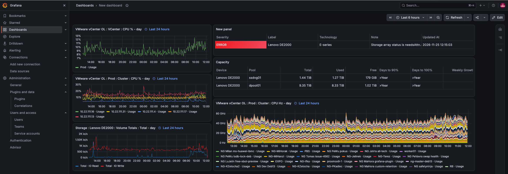
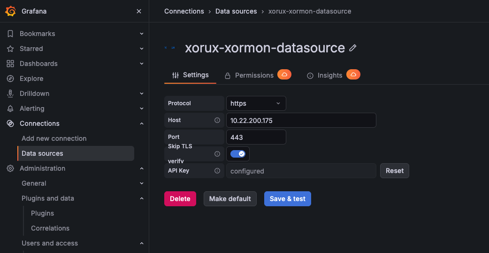
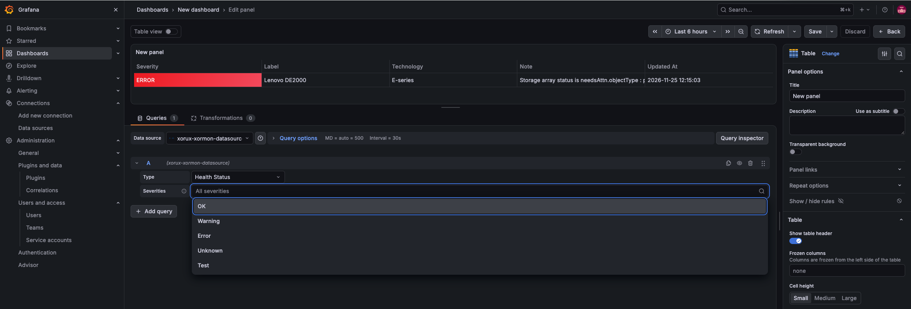

# XorMon Data Source

The XorMon data source brings the data of your [XorMon](https://www.xormon.com) infrastructure monitoring into
Grafana: performance metrics, health status and capacity of your storage, SAN, LAN, servers and virtualization,
queried live from your XorMon server.

- **Timeseries**: graph any metric of any item monitored by XorMon.
- **Health Status**: a color-coded table of device health.
- **Capacity**: a color-coded capacity table of storage devices, pools and volumes.
- **XorMon URL**: graphs, capacity tables and alerting tables imported from XorMon pages and dashboards. They stay linked to
  their XorMon page, so the panels follow changes of the source graph.

Graphs imported from XorMon no longer need the Infinity plugin.

## Requirements

- Grafana **12.3.0** or newer.
- A XorMon server reachable from the Grafana server (default port `8443`, HTTPS).
- A XorMon **API key**, generated in XorMon under **User → Profile → API Keys**.
- A XorMon license that includes API access for the technologies you want to query.

## Getting started

### Add the data source

In Grafana, go to **Connections → Data sources → Add data source** and search for **XorMon**. Fill in:

| Field           | Description                                                                |
| --------------- | -------------------------------------------------------------------------- |
| Protocol        | `http` or `https`, matching your XorMon server                             |
| Host            | Hostname or IP address of your XorMon server                               |
| Port            | Usually `8443`                                                             |
| Skip TLS verify | Enable this if your XorMon server uses the default self-signed certificate |
| API Key         | The XorMon API key                                                         |

Click **Save & test**. It should confirm a successful connection.

### Build a panel

Open **Explore** (or add a panel to a dashboard) and pick the XorMon data source. The query editor starts with a
**Type** selector:

- **Timeseries**: pick **Class → HW Type → Subsystem** (for the Storage, SAN and LAN classes, HW Type is skipped
  because the subsystem list already spans every hardware type), then the **Items** to graph (or click
  **Select all** to always include every matching item, resolved fresh each time the query runs) and the
  **Metrics** to plot. When exactly one item is selected, you can assign a fixed color per metric; with several
  items, Grafana's own color palette takes over. Optionally enable **Filter by parents** to pick items indirectly
  through their parent devices.
- **Health Status**: a color-coded table of device health (OK / Warning / Error / Unknown / Test), with an
  optional filter by severity.
- **Capacity**: a color-coded table of capacity figures (Total / Used / Free, Used %, and reduction/dedupe ratios
  where available) for Storage **Device**, **Pool** or **Volume** items.

- **XorMon URL**: a graph, capacity table or alerting table of a XorMon page. These panels are created from XorMon
  (adding a graph or table to a Grafana dashboard, or syncing XorMon dashboards), not built by hand. The editor
  shows the page **URL**, **Tab** / **Tab ID** and the graph or table id. XorMon looks the graph or table up on
  every refresh, so the panel follows changes of the page (new items, metrics); the import only keeps the XorMon
  styling of the metrics.

## Troubleshooting

- **"Missing API key" / "Bad or expired API key"**: the key may have expired or been revoked. Generate a new one
  in XorMon.
- **"The Xormon instance does not have a valid license."**: the XorMon license is not valid or doesn't include API
  access for the queried technology.
- **Class / HW Type / Item dropdowns stay empty**: check that the Grafana server (not your browser) can reach the
  XorMon host and port you configured.
- **TLS / certificate errors**: enable **Skip TLS verify** in the data source settings if your XorMon server uses
  its default self-signed certificate, or install a CA-signed certificate on the XorMon server.

## Documentation

- [XorMon](https://www.xormon.com)
- [Changelog](https://github.com/XoruX/grafana-plugin/blob/main/CHANGELOG.md)

## Contributing

Report bugs and feature requests in the [issue tracker](https://github.com/XoruX/grafana-plugin/issues). Developer
documentation is in [CONTRIBUTING.md](https://github.com/XoruX/grafana-plugin/blob/main/CONTRIBUTING.md).

## License

[Apache License 2.0](https://github.com/XoruX/grafana-plugin/blob/main/LICENSE)
